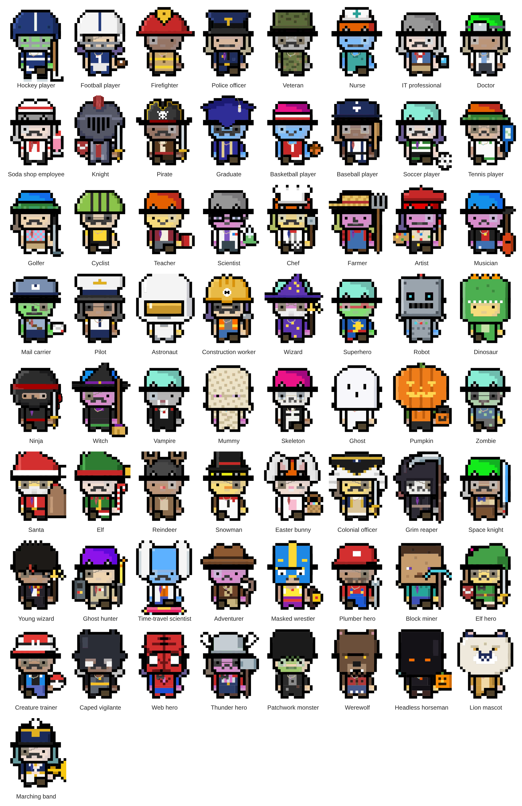

# Named characters

Every character type (`preset`) that ships with `rpg-character`: 65 in all.
Use one with `<rpg-character preset="..." seed="..."></rpg-character>`. The seed
still decides skin, face and the other seed traits, and any default piece
can be swapped by setting that attribute. The code recreates the preset on
the default (blank) seed with `<rpg-character code="...">`.

Live version: `demo/characters.html`. This file and `characters.png` are
generated by `node scripts/roster.mjs`; don't edit them by hand.

## How many characters?

- **60,890,117,571,360,000** different-looking characters
  (head 111 × skin 10 × face 21 × faceItem 10 × accessories 10 × outfit 165 × hat and fire 121 × mask 12 × pet 11 × expression 7 × circle 2 × feet 4 × pose and hands 177).
- **66,000,000** of those come from a seed alone, before choosing anything.
- **239,738,895,728,640,000,000** possible character codes. Codes also record
  choices that end up hidden, such as hair on base 0.

See "How many characters are there?" in the README for how this is counted.

## The list

| # | Character | preset | Default pieces | Code |
| --- | --- | --- | --- | --- |
| 1 | Hockey player | `hockey` | hat: Hockey helmet, item: Hockey stick, feet: Skates | `1-00000000000000000001` |
| 2 | Football player | `football` | hat: Football helmet, item: Football | `1-00000000000000000002` |
| 3 | Firefighter | `firefighter` | hat: Firefighter helmet | `1-00000000000000000003` |
| 4 | Police officer | `police` | hat: Police cap | `1-00000000000000000004` |
| 5 | Veteran | `veteran` | hat: Military cap | `1-00000000000000000005` |
| 6 | Nurse | `nurse` | hat: Nurse cap | `1-00000000000000000006` |
| 7 | IT professional | `it` | item: Phone | `1-00000000000000000007` |
| 8 | Doctor | `doctor` | hat: Head mirror | `1-00000000000000000008` |
| 9 | Soda shop employee | `soda` | hat: Soda shop cap, item: Milkshake | `1-00000000000000000009` |
| 10 | Knight | `knight` | hat: Knight, item: Sword, offhand: Shield | `1-0000000000000000000a` |
| 11 | Pirate | `pirate` | hat: Pirate, item: Sword | `1-0000000000000000000b` |
| 12 | Graduate | `graduate` | hat: Education | `1-0000000000000000000c` |
| 13 | Basketball player | `basketball` | hat: Headband, item: Basketball | `1-0000000000000000000d` |
| 14 | Baseball player | `baseball` | hat: Baseball cap, item: Baseball bat | `1-0000000000000000000e` |
| 15 | Soccer player | `soccer` | item: Soccer ball | `1-0000000000000000000f` |
| 16 | Tennis player | `tennis` | hat: Visor, item: Tennis racket | `1-0000000000000000000g` |
| 17 | Golfer | `golf` | hat: Visor, item: Golf club | `1-0000000000000000000h` |
| 18 | Cyclist | `cycling` | hat: Bike helmet | `1-0000000000000000000i` |
| 19 | Teacher | `teacher` | item: Book | `1-0000000000000000000j` |
| 20 | Scientist | `scientist` | hat: Safety goggles, item: Science flask | `1-0000000000000000000k` |
| 21 | Chef | `chef` | hat: Chef hat, item: Spatula | `1-0000000000000000000l` |
| 22 | Farmer | `farmer` | hat: Straw hat, item: Pitchfork | `1-0000000000000000000m` |
| 23 | Artist | `artist` | hat: Beret, item: Paintbrush, offhand: Paint palette | `1-0000000000000000000n` |
| 24 | Musician | `musician` | item: Guitar | `1-0000000000000000000o` |
| 25 | Mail carrier | `mail` | hat: Mail carrier cap, item: Letter | `1-0000000000000000000p` |
| 26 | Pilot | `pilot` | hat: Pilot cap | `1-0000000000000000000q` |
| 27 | Astronaut | `astronaut` | hat: Space helmet | `1-0000000000000000000r` |
| 28 | Construction worker | `construction` | hat: Construction, item: Hammer | `1-0000000000000000000s` |
| 29 | Wizard | `wizard` | hat: Wizard hat, makeup: White beard, item: Magic wand | `1-0000000000000000000t` |
| 30 | Superhero | `superhero` | makeup: Hero mask | `1-0000000000000000000u` |
| 31 | Robot | `robot` | hat: Robot head | `1-0000000000000000000v` |
| 32 | Dinosaur | `dinosaur` | hat: Dinosaur hood | `1-0000000000000000000w` |
| 33 | Ninja | `ninja` | hat: Ninja, item: Sword | `1-0000000000000000000x` |
| 34 | Witch | `witch` | hat: Witch hat, item: Broom | `1-0000000000000000000y` |
| 35 | Vampire | `vampire` | makeup: Fangs | `1-0000000000000000000z` |
| 36 | Mummy | `mummy` | mask: Mummy | `1-00000000000000000010` |
| 37 | Skeleton | `skeleton` | makeup: Skull paint | `1-00000000000000000011` |
| 38 | Ghost | `ghost` | mask: Ghost | `1-00000000000000000012` |
| 39 | Pumpkin | `pumpkin` | mask: Pumpkin, item: Candy bucket | `1-00000000000000000013` |
| 40 | Zombie | `zombie` | makeup: Zombie paint | `1-00000000000000000014` |
| 41 | Santa | `santa` | hat: Santa hat, makeup: White beard, item: Gift sack | `1-00000000000000000015` |
| 42 | Elf | `elf` | hat: Elf hat, item: Candy cane | `1-00000000000000000016` |
| 43 | Reindeer | `reindeer` | hat: Antlers, makeup: Red nose | `1-00000000000000000017` |
| 44 | Snowman | `snowman` | hat: Top hat, makeup: Carrot nose | `1-00000000000000000018` |
| 45 | Easter bunny | `easter-bunny` | hat: Bunny, makeup: Bunny nose, item: Egg basket | `1-00000000000000000019` |
| 46 | Colonial officer | `colonial` | hat: Tricorn and wig, item: Sword | `1-0000000000000000001a` |
| 47 | Grim reaper | `reaper` | hat: Hooded cloak, makeup: Skull paint, item: Scythe | `1-0000000000000000001b` |
| 48 | Space knight | `space-knight` | item: Laser sword (blue) | `1-0000000000000000001c` |
| 49 | Young wizard | `boy-wizard` | hat: Messy hair with scar, makeup: Round glasses, item: Magic wand | `1-0000000000000000001d` |
| 50 | Ghost hunter | `ghost-hunter` | item: Beam wand, offhand: Ghost-hunting pack | `1-0000000000000000001e` |
| 51 | Time-travel scientist | `time-scientist` | hat: Wild white hair, feet: Hoverboard, shaved head | `1-0000000000000000001f` |
| 52 | Adventurer | `adventurer` | hat: Fedora, item: Whip | `1-0000000000000000001g` |
| 53 | Masked wrestler | `wrestler` | mask: Wrestling mask, item: Championship belt | `1-0000000000000000001h` |
| 54 | Plumber hero | `plumber` | hat: Plumber's cap, makeup: Mustache, item: Wrench | `1-0000000000000000001i` |
| 55 | Block miner | `miner` | mask: Block head, item: Pickaxe | `1-0000000000000000001j` |
| 56 | Elf hero | `elf-hero` | hat: Long pointed cap, item: Sword, offhand: Shield | `1-0000000000000000001k` |
| 57 | Creature trainer | `trainer` | hat: Trainer's cap, item: Capture ball | `1-0000000000000000001l` |
| 58 | Caped vigilante | `vigilante` | hat: Cowl with ears | `1-0000000000000000001m` |
| 59 | Web hero | `web-hero` | mask: Web mask | `1-0000000000000000001n` |
| 60 | Thunder hero | `hammer-god` | hat: Winged helmet, item: War hammer | `1-0000000000000000001o` |
| 61 | Patchwork monster | `monster` | hat: Flat-top hair, makeup: Monster face paint | `1-0000000000000000001p` |
| 62 | Werewolf | `werewolf` | mask: Werewolf face | `1-0000000000000000001q` |
| 63 | Headless horseman | `horseman` | mask: Shadowy face, item: Jack-o'-lantern | `1-0000000000000000001r` |
| 64 | Lion mascot | `mascot` | mask: Lion | `1-0000000000000000001s` |
| 65 | Marching band | `band` | hat: Band shako, item: Trumpet | `1-0000000000000000001t` |
